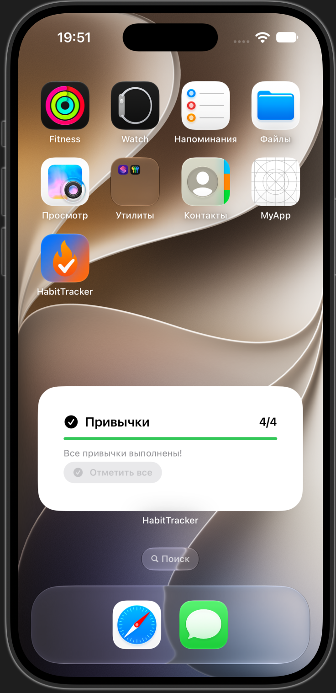
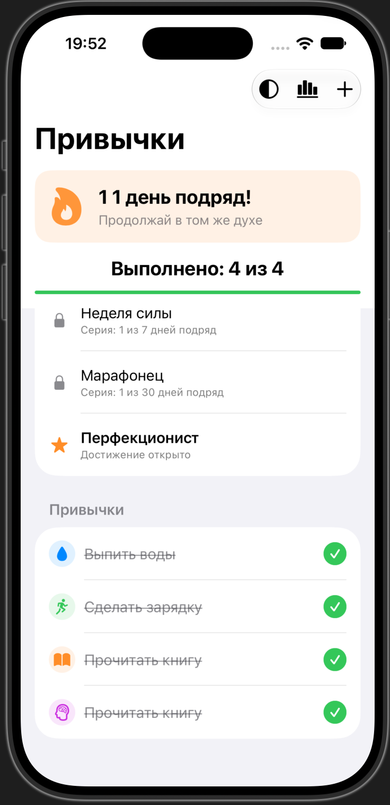
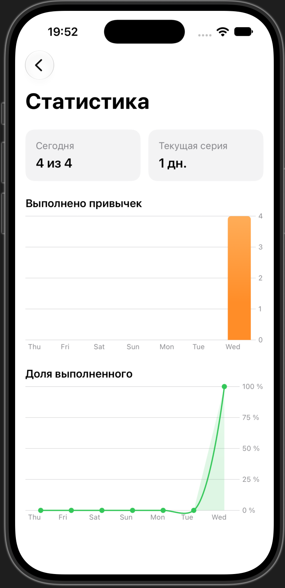
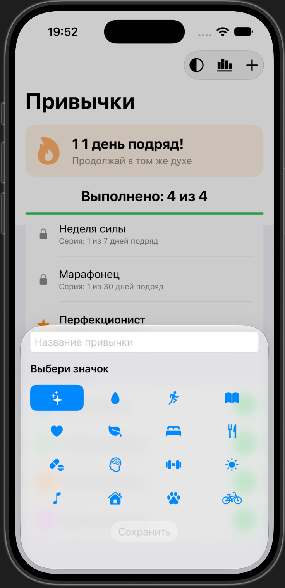

# Habit Tracker

iOS-приложение для отслеживания привычек с достижениями, статистикой и виджетом.

## Возможности

- Создание, отметка и удаление привычек с иконками SF Symbols
- Серия выполненных дней (streak) с анимированным индикатором
- Достижения за регулярное выполнение привычек
- Экран статистики с графиками на SwiftUI Charts
- Звуковой отклик при выполнении привычки
- Выбор системной, светлой или тёмной темы
- Анимация конфетти при достижении дневной цели
- Виджет прогресса с интерактивной кнопкой «Отметить все»
- Локальное хранение привычек и статистики
- Обмен данными между приложением и виджетом через App Groups
- Локальные напоминания о привычках

## Скриншоты

<table>
  <tr>
    <td align="center">
      <strong>Главный экран и виджет</strong><br>
      
    </td>
    <td align="center">
      <strong>Привычки и достижения</strong><br>
      
    </td>
  </tr>
  <tr>
    <td align="center">
      <strong>Статистика</strong><br>
      
    </td>
    <td align="center">
      <strong>Добавление привычки</strong><br>
      
    </td>
  </tr>
</table>

## Технологии

- Swift и SwiftUI
- MVVM-подход
- WidgetKit и App Intents
- App Groups
- SwiftUI Charts
- AVFoundation
- UserDefaults
- SF Symbols

## Структура исходников

```text
MyApp/
├── Assets.xcassets/
├── Models/
│   ├── Habit.swift
│   └── HabitAchievement.swift
├── Services/
│   ├── AudioFeedback.swift
│   ├── HabitReminderScheduler.swift
│   └── HabitStore.swift
├── Shared/
│   └── HabitWidgetData.swift
├── Views/
│   ├── AchievementsSection.swift
│   ├── AddHabitSheet.swift
│   ├── AnimatedCheckToggleStyle.swift
│   ├── ConfettiOverlay.swift
│   ├── HabitRow.swift
│   ├── StatisticsView.swift
│   └── StreakBanner.swift
├── Widgets/
│   └── HabitProgressWidget.swift
├── ContentView.swift
└── MyApp.swift
```

## Требования

- macOS с установленным Xcode
- Для сборки текущей конфигурации проекта требуется iOS 27 SDK
- WidgetKit-интерактивность требует iOS 17 или новее

## Получение исходников

```bash
git clone https://github.com/nikon-ios-dev/HabitTracker.git
cd HabitTracker
```

Репозиторий содержит исходные файлы приложения. Файл проекта `.xcodeproj` в него пока не включён, поэтому команду `open HabitTracker.xcodeproj` выполнить нельзя. Для сборки откройте или создайте iOS-проект в Xcode, добавьте исходники из этого репозитория и настройте Widget Extension. Для обмена данными между приложением и виджетом включите в обоих targets одну App Group: `group.com.nikon.habitracker`.

## Добавление виджета

1. Установите и запустите приложение на устройстве или в симуляторе.
2. Перейдите на главный экран и удерживайте свободное место.
3. Нажмите «+» и найдите виджет «Прогресс привычек».
4. Выберите размер и добавьте виджет.
5. Нажмите «Отметить все», чтобы выполнить все привычки за сегодня.

## Планы

- Синхронизация через iCloud
- Экспорт статистики в PDF
- Интеграция с Siri
- Live Activities
- Версия для Apple Watch
- Локализация

## Автор

Никон Тынаев — iOS-разработчик

GitHub: [nikon-ios-dev](https://github.com/nikon-ios-dev)
